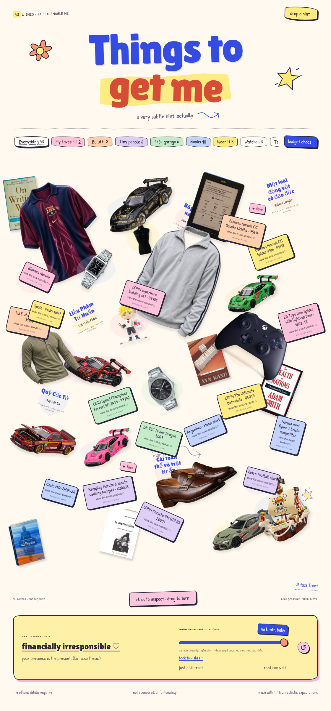

# Open the wishlist on your Mac

Download this branch from GitHub, unzip it, and double-click **OPEN-WISHLIST.html** in Finder. If needed, right-click it and choose **Open With → Safari or Google Chrome**. No installation or server is required.

The file contains the current 43-item wishlist and embedded local photos/styles. Some online book/figure references and Pinterest previews need Internet access. Open it from Finder rather than the chat app file viewer.

---

# Things to get me

A personal floating wishlist with 43 wishes, one editorial collage, drag-to-turn photos, product-reference images, scene zoom, and a VND budget slider. Requires Node.js 18+; no dependencies. Run `npm start` (port 3000; override with `PORT`).

## Collections

All 43 gifts occupy a single art-directed canvas: varied sizes, angles and overlaps, with no pages or grid. Category and VND budget controls spotlight matching gifts without changing their positions. Unpriced wishes are dimmed for finite budgets. All active gifts are keyboard accessible.

Drag any gift horizontally to rotate its flat photograph, or use Left/Right arrow keys while focused. Home resets that gift; “face front” resets every photo. A short click opens the zoomed details. Touch users can still scroll vertically. These are playful photo rotations, not true multi-angle product photography or 3D models.

The 19 latest additions are two Blokees figures, six diecast wishes (Roxy and Rexy are separate), a 30,000 VND Naruto brick-compatible minifigure, and ten books. Existing wishes and Instagram links remain.

Diecast references: Mini GT Mazda RX-7 LB-Super Silhouette FD-NILES #1101; Kaido House R34, pictured red TAMIYA Hornet V2 KHMG315; user-approved Mini GT Roxy #872 and Rexy #889; Porsche 911 GT3 R, pictured Mini GT #770 with requested Pop Race maker not verified; Pop Race Darwin Pro Supra PR640076. These are references; choose exact livery and SKU before purchasing.

Books: On Writing Well (William Zinsser); Distinction (Pierre Bourdieu); Một loài động vật có đạo đức (Robert Wright); Cái toàn thể và trật tự ẩn (David Bohm); Liễu Phàm Tứ Huấn (Viên Liễu Phàm); Quỷ Cốc Tử; Của cải của các dân tộc (Adam Smith); Suối nguồn (Ayn Rand); Câu chuyện dòng sông / Siddhartha (Hermann Hesse); Búp sen xanh (Sơn Tùng). Covers are edition references and may be the original English or French edition, not a guarantee of the desired Vietnamese translation.

## Images and network access

Existing cutouts, six car references, and five book references are local and embedded in the single-file preview. Background removal used ImageGen; small decals or occluded areas may have been reconstructed, so edited cutouts are not pixel-exact proof of a product listing. Original source photos remain in assets/products. Lossless WebP copies are checked against PNG decoded RGBA pixels to reduce the download size.

Two Blokees reference photos and two ISBN cover references are online images. Three books with no local cover use an optional Open Library title/author lookup, requiring an exact normalized title and author match before displaying a cover. These network sources were identified but cannot be fetched/verified under the current workspace network policy. When a cover is unavailable, a clearly labeled title/author link appears instead of a fabricated edition cover. The cheap Naruto minifigure and the existing MQ-24DA-2A are product links without substitute imagery.

Remote photos need Internet access even in the downloadable preview. Network domain additions are saved in the environment draft, but that does not apply or publish them. The existing runtime still blocks these sources. User review/save and environment publication are required to enable them in cloud checks.

Casio MQ-24DA-2A retains the exact user-provided retailer URL. Clothing references link create_classic_menswear and nhatung.23; the photos are not claims about these shops' exact inventory. The loafer source is a general reference of unverified brand, with a separate Vagabond style link. Publicly available images do not establish commercial licensing. Original watermarks and source/license files are retained.

## Budgets and export

Amounts are user wishlist budgets, not verified live offers. Only the new small Naruto minifigure receives a new price (approximately 30,000 VND). Other added budgets remain unset. Prior user budgets remain unchanged.

Run `python scripts/package-preview.py` to create `/workspace/Things-to-get-me.zip`. Download, extract, and open index.html from Finder/File Explorer in Chrome or Safari. The chat app file viewer displays HTML source as text. Local images/styles work offline; online covers, Blokees photos and shopping links need Internet access.

Customize the gifts array in app.js. Image sources and statuses are recorded in assets/products/sources.json. No accounts or database.

## Pending Pinterest art direction

The headline is oversized and centered, using the existing bundled Lilita One font as an interim choice. The old headline smiley is removed. Exact font matching and the requested Nudaeng dog sticker replacement/accents await accessible source images: the workspace proxy returns HTTP 403 for Pinterest. No substitute dog was drawn or presented as the referenced character. Supplied pins: actual first link target 835488168417774119 (displayed label 1089097122422311502), dog reference 1013661828634973925, additional references 1021472759239980088, 799389002651132199, and 811703532876054507.

The quarter-zip detail card includes the exact requested outfit pin, https://www.pinterest.com/pin/1102889396316398041/, through Pinterest's public embed plus a direct-link fallback. Only the quarter-zip loads this embed, when opened; it is removed on close or switching wishes. Its live contents cannot be verified from this workspace. The floating cutout has not been replaced with an unseen outfit. A downloaded reference image is required for that replacement. The embed needs Internet even in the downloadable HTML.

## Colorful hand-drawn styling

The site now uses a warm dotted paper surface, cobalt/coral headline, yellow marker highlight, irregular borders and hard-offset shadows, pastel category tabs, per-gift color washes, and inline original SVG flowers, stars, arrows and scribbles. Gift photographs and all catalogue data remain intact. Patrick Hand is embedded locally for handwritten labels, with its SIL license included in the ZIP. The supplied Pinterest style pin 934285885210907727 could not be inspected under the runtime policy, so this is an interpretation of the user's “colorful with imperfect handdraw” direction, not an exact reproduction of the unseen pin. Nudaeng dog assets still require accessible reference images.

## Hosted preview preparation

Run `python3 scripts/build-static.py` to generate `dist/`. This build uses relative asset URLs so it works at both a site root and a repository path such as `/wishlist/`. Only the deployed HTML, JavaScript, styles, referenced images and attribution/license files are copied; source photographs and local workspace metadata are excluded. The output directory is ignored by Git.

`.github/workflows/pages.yml` is prepared to deploy the build with GitHub Pages after a main-branch push or manual dispatch. Configure Pages requests enablement with the workflow token; repository administration settings may require owner action if GitHub refuses it. This workflow has not been pushed or run, and no public site has been published. Publication requires the user's approval because GitHub Pages makes the wishlist publicly accessible.

## Cloudflare preview preparation

The user authorized a Cloudflare public preview. Anonymous Quick Tunnel cannot currently start: api.trycloudflare.com returns HTTP CONNECT 403 from the environment proxy, and the runtime has no outbound TCP grants for tunnel transport. No tunnel URL was created.

Cloudflare Pages direct upload is the alternative, using the static dist build over HTTPS. The official Wrangler CLI 4.157.0 is installed at /workspace/.tools/cloudflare, outside application dependencies. api.cloudflare.com is currently denied by the running HTTP policy. Cloudflare API token/account ID were not present in bindings or process variables, and no cached Wrangler login was found.

The draft now declares CLOUDFLARE_API_TOKEN (secure environment secret bound only to api.cloudflare.com) and CLOUDFLARE_ACCOUNT_ID (runtime variable), and retains previous allowed hosts while adding api.cloudflare.com plus the intended br1anng-wishlist.pages.dev preview hosts. Saving this draft did not apply the network changes or provide credentials. User review/save and environment publication are required. Use a Cloudflare token scoped to Cloudflare Pages Edit on the intended account; never put it in source files or chat.

The intended project is br1anng-wishlist, preview branch codex-preview. Neither the Cloudflare project nor a deployment has been created. The GitHub Pages workflow is only a local alternative and has not been pushed/run; Cloudflare is the selected route.

Once the saved bindings and HTTP policy are applied, run `python3 scripts/deploy-cloudflare.py`. It rebuilds the static site, creates the dedicated Pages project only if absent, and publishes the `codex-preview` branch using the existing proxy. It does not alter production project settings or delete resources. `--check` validates local prerequisite presence without network requests. Its current check exits 2 because both Cloudflare bindings are missing. Wrangler's version and supported Pages command options were verified, including its recognition of the environment HTTPS proxy. No credential values are stored in the repository.

## Price correction — 4 November 2026

Casio LTP-V007D-1E is now budgeted below 1,000,000 VND, correcting the earlier 2,000,000 VND ceiling. This is a user-confirmed budget, not a verified shop quote. The runtime still denies external retailer/search requests with HTTP CONNECT 403, so no new prices were invented for the remaining gifts. Existing unspecified budgets stay unspecified. The Mac HTML is rebuilt after this correction; previously downloaded copies need replacing to receive it.

## Editorial update — 4 November 2026

Added locally verified real English covers for The Wealth of Nations and The Fountainhead, bringing local images to 21 of 33 wishes. The remaining twelve use online image references or clearly labeled product/title links. Direct retailer, cover and search access is still blocked by the environment; no product photo or missing edition was invented.

Verified in Chromium at 1440px and 390px: 33 gifts on one canvas, fixed-position category/budget spotlighting, pointer rotation without accidental detail opening, keyboard rotation/reset, mobile horizontal overflow and detail-panel bounds.

## Football wishes and price review — 4 November 2026

Replaced the modern Barcelona shirt wish with four separate wishes: Spain Pedri, Argentina Messi, retro Barça, and an open-choice retro football shirt. The collage now has 33 gifts. Each shirt carries over the existing approximately 300,000 VND target; these are not live offers. The retro Barça photo is a real 2001/02-style reference, with a photo-derived transparent cutout and original source retained. The other three have clearly labeled product-search links pending matching photos.

Retried Google, Casio Vietnam, Fahasa, Kindle Hanoi and a Vietnamese football-shirt retailer. All were blocked with HTTP CONNECT 403. No full live-price update is claimed. See assets/products/price-review.json for the per-gift budget/unknown status and lookup links. Existing Casio LTP target remains below 1,000,000 VND.

## Updated Barça reference — 4 November 2026

The active retro Barça wish now uses the user-supplied burgundy/navy collared-shirt reference, replacing the earlier 2001/02-style preview. The image is a photo-derived transparent cutout: person, stadium and jewelry removed, with obscured neckline areas and the cropped hem reconstructed. It is a style preview, not exact-release verification. The 300,000 VND budget target remains unchanged. All 33 gifts remain on the same collage.

## Linked building sets and favorites — 4 November 2026

Saved all 11 requested shop links. The existing Blokees Spider-Man wish now targets model 81118, replacing the previous generic 74801 reference. Ten other entries are added, bringing the collage to 43. Naruto & Hinata K20508 and Sasuke 75614 have visible favorite badges and a My faves spotlight tab. Non-LEGO brands are labeled individually. The numeric Shopee link 91626123/41326999550 is the Going Merry pirate ship from One Piece, identified by the user; exact brand/model are still unverified.

All 11 shop requests failed with HTTP CONNECT 403 under the active cloud network policy. Their VND prices remain explicitly unverified and no uninspected photo was substituted or represented as a completed cutout. Listing/model references and Shopee image identifiers are recorded in assets/products/requested-listings.json; price status is recorded in price-review.json. No image edits were attempted without the actual source images.

The environment draft now adds www.mykingdom.com.vn, mykingdom.com.vn, shopee.vn, www.shopee.vn, saigonbrick.com.vn, www.saigonbrick.com.vn, down-vn.img.susercontent.com, cf.shopee.vn, product.hstatic.net and theme.hstatic.net while preserving the existing domains. Backend save succeeded and requires_publish is true. This does not apply the policy. Review and save in Environment settings, then Publish, before retrying the listing requests.

## Going Merry screenshot — 4 November 2026

The user supplied a Shopee screenshot for Going Merry. It shows a listing-wide range of 785,000–1,659,000 VND, with Going Merry/Baratie and with/without-box variants. The site displays that full range and explicitly leaves the exact ship/box price unconfirmed. Finite budget filters use the upper endpoint (1,659,000 VND); this is a conservative filter ceiling, not a claimed exact seller price or user budget. The listing title says 1372 pieces.

A transparent cutout is derived from the main ship photo in the screenshot, removing the background, detached sticker, UI and supporting hand. Small hull areas hidden by the hand may be reconstructed. This is the 22nd embedded local image; all 43 wishes remain. The other ten newly requested listing images/prices still require accessible source pages or screenshots.
